<p align="center">
  
</p>

<h1 align="center">Kellyfin</h1>

<p align="center">
  A fast, self-hosted home for your movies and series — a from-scratch alternative to Jellyfin,
  with a Rust server and light apps for the web, desktop and phones.
</p>

<p align="center">
  <a href="https://github.com/datlt4/Kellyfin/releases/latest">Download</a> ·
  <a href="#run-the-server">Run the server</a> ·
  <a href="#migrate-from-jellyfin">Migrate from Jellyfin</a> ·
  <a href="docs/HANDOFF.md">Developer handoff</a>
</p>

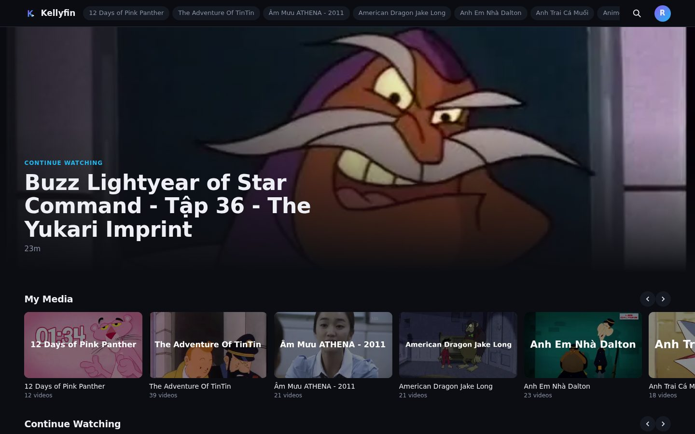

## Why

Kellyfin was written to fix what hurt in daily Jellyfin use on a small home server:

- **Playback that starts right away**, on the LAN and over a VPN. Files the device can play are sent as they
  are, with instant seeking; anything else is converted on the fly, only for the part being watched.
- **Thumbnails that never go missing.** Every image is rendered once into small WebP files and cached forever
  by the browser.
- **Light enough for old phones.** The web app is about 25 KB of JavaScript, and the same UI runs in the apps.
- **The Jellyfin layout you already know**, redesigned: library bar on top, My Media, Continue Watching,
  Recently Added per library.

## Features

**Watching**
- Direct play, a lossless remux (MKV, other audio tracks), or an on-demand HLS transcode — chosen automatically,
  with fallback when a device refuses a file.
- Quality menu from the original down to 144p, without storing any extra copies. *Auto* picks a quality from
  your bandwidth and screen size.
- Hardware transcoding: **VAAPI** (AMD / Intel GPU), **NVENC** (NVIDIA), or x264 on the CPU.
- Subtitles from `.srt` / `.vtt` / `.ass` files next to the video or embedded in it; **dual subtitles** for
  language learning (a second language above the first).
- Audio track switching, playback speed 0.25×–2×, resume where you left off, auto-play of the next episode
  (and of the next season).
- Picture-in-picture, fullscreen, keyboard shortcuts, double tap a side on phones to skip ±10 s.
- Black bars around the picture are found during the scan and cut away in the player and the thumbnails
  (one button turns it off); files are never modified.
- Cast to **Chromecast** (Chrome) and **AirPlay** (Safari / iOS).

**Library**
- Libraries of folders, scanned in the background; titles and thumbnails editable, or taken from the file name
  and a frame of the video.
- Accent-insensitive search (`am muu` finds *Âm Mưu*), where numbers match whole (*Tập 1* is not *Tập 10*).
- Suggestions by title: other seasons and related series on every video page.
- Import from Jellyfin (libraries, folders, titles, images, watch progress), and export/import of Kellyfin's own
  data.
- A repair tool for wrong titles and posters that Jellyfin matched online to unrelated films.

**Server and apps**
- Users, avatars, passwords; dashboard with now-playing sessions, scans, restart.
- Apps for Windows, macOS, Linux, Android and iOS. Several servers can be saved and switched in one tap,
  including servers behind an authenticating proxy such as Pangolin that needs extra request headers.
- The apps check for new versions: desktop apps update themselves (signed), Android opens the new APK.
- **AI upscaling (experimental)**: GPU workers turn low-resolution videos into 1080p copies, chosen per library
  or episode, that appear as an extra quality in the player.

## Screenshots

| Library | Video page |
|---|---|
| 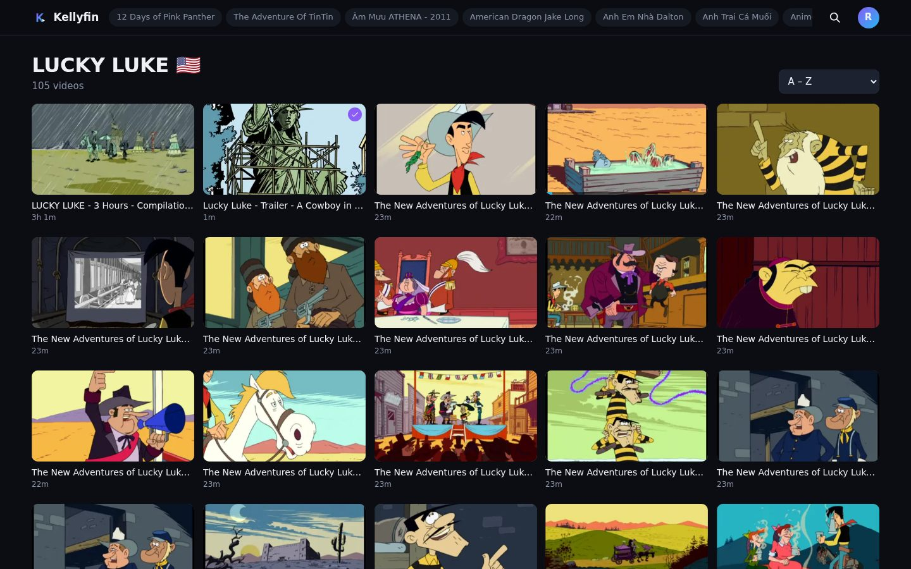 | 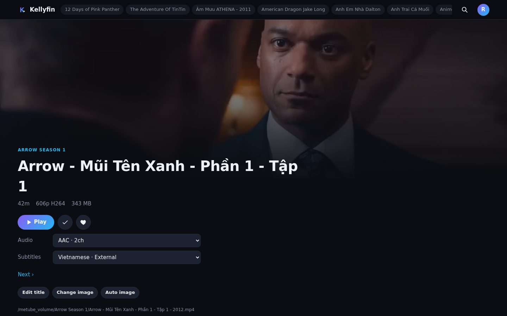 |

| Dual subtitles | Subtitle menu |
|---|---|
|  | 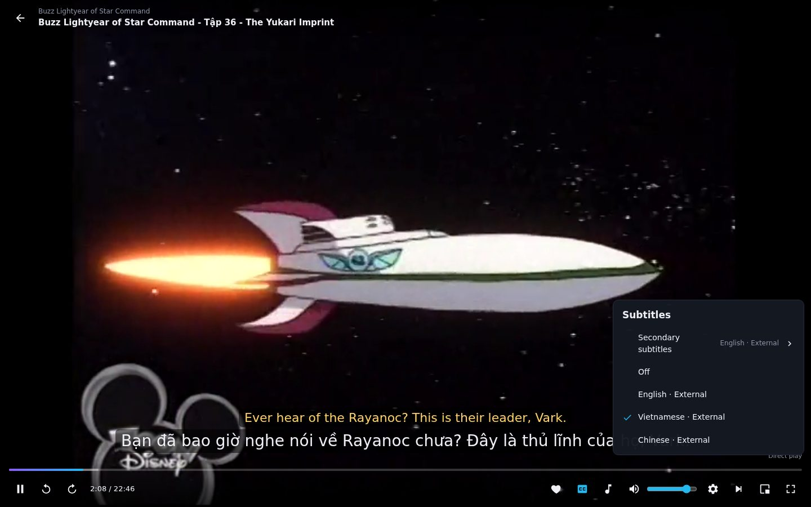 |

| Dashboard | Libraries |
|---|---|
| 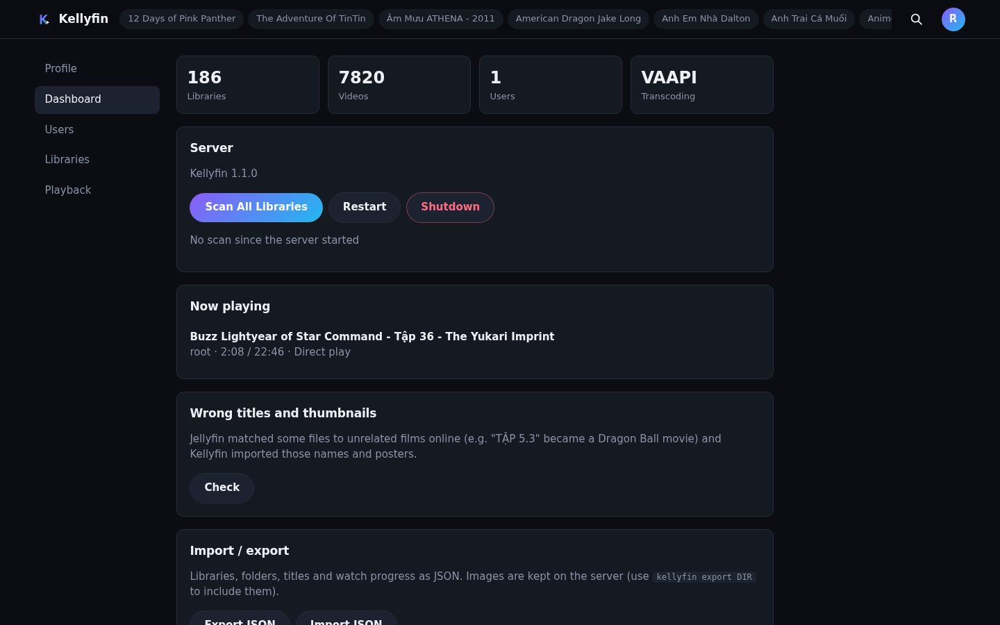 | 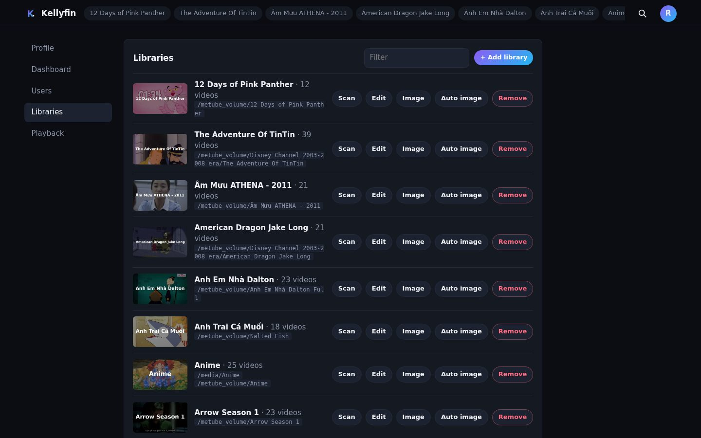 |

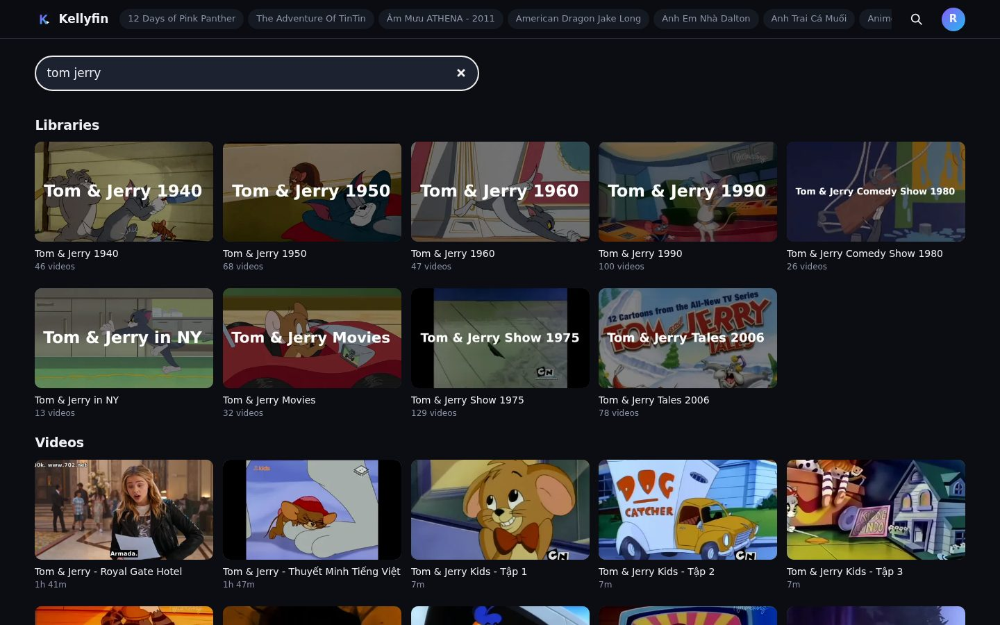

On a phone:

<p>
  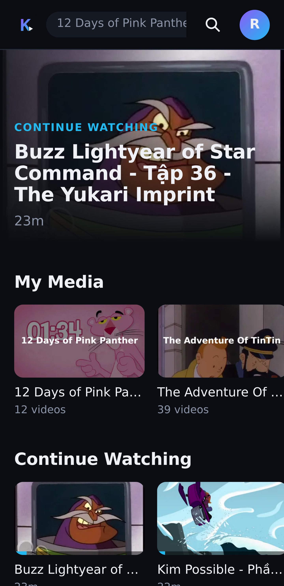
  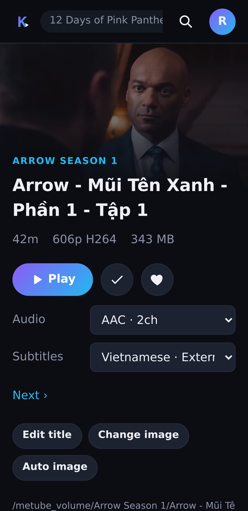
  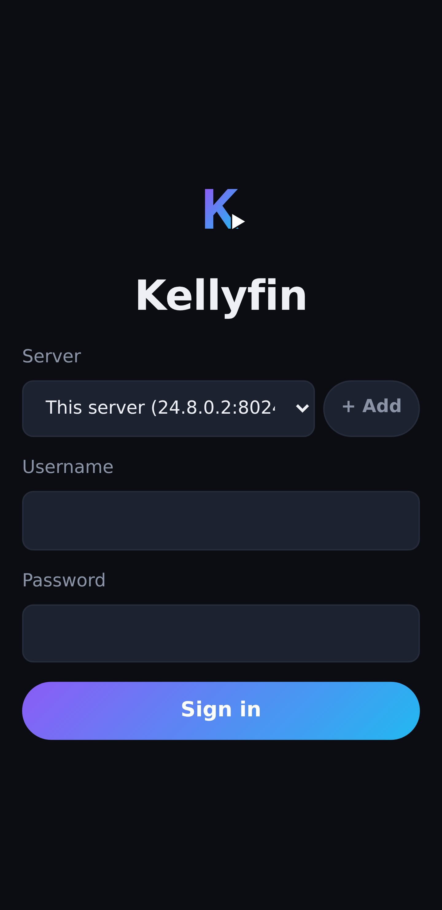
</p>

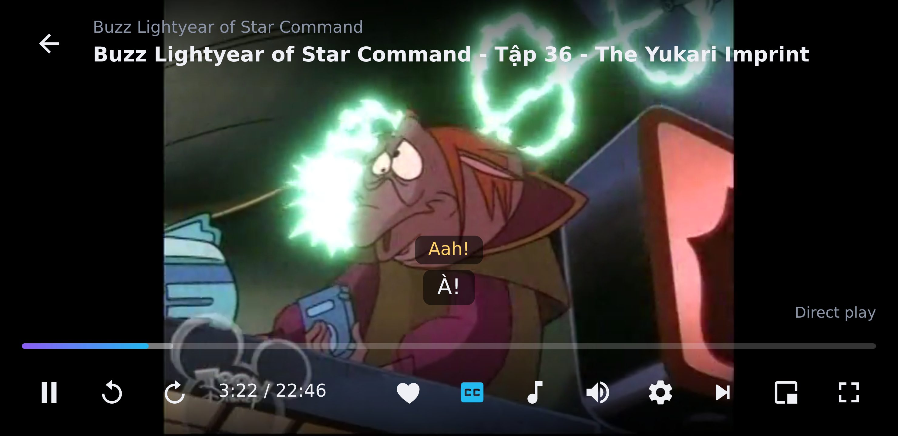

## Apps

Download from the [latest release](https://github.com/datlt4/Kellyfin/releases/latest):

| Platform | File |
|---|---|
| Windows (x64, x86, ARM64) | `*-setup.exe`, `*.msi`, or the portable `.zip` |
| macOS (Apple Silicon, Intel) | `*.dmg` |
| Linux (x64, ARM64) | `.deb`, `.rpm`, `.AppImage` |
| Android 7+ | `kellyfin_android_*.apk` |
| iOS | `kellyfin_ios_*_unsigned.ipa` — sign it with your Apple ID (AltStore, Sideloadly, or Xcode) |

The browser needs no install: open the server's address.

## Run the server

Requirements: Docker, and ideally a GPU for transcoding (AMD/Intel through `/dev/dri`, or NVIDIA with the
NVIDIA Container Toolkit).

```yaml
# docker-compose.yml
services:
  kellyfin:
    image: hienanh/kellyfin:latest
    container_name: kellyfin
    restart: unless-stopped
    user: "1000:1000"
    ports:
      - "8024:8080"
    environment:
      KELLYFIN_ADMIN_PASSWORD: change-me     # first start only; otherwise a random one is logged
    devices:
      - /dev/dri:/dev/dri                    # AMD / Intel GPU (VAAPI)
    group_add:
      - "110"                                # the host's "render" group id
    volumes:
      - ./data:/data                         # database, images, transcode scratch
      - /path/to/movies:/movies:ro           # media, read-only
```

```sh
docker compose up -d
```

Open `http://<server>:8024`, sign in as `root`, then add libraries in **Settings → Libraries** (folders are picked
from what the container sees). The server never writes to media folders.

NVIDIA instead of VAAPI: install the NVIDIA Container Toolkit and add

```yaml
    deploy:
      resources:
        reservations:
          devices:
            - driver: nvidia
              count: all
              capabilities: [gpu, video]
```

then choose the encoder in **Settings → Playback** (*Auto* prefers NVIDIA, then VAAPI, then the CPU).

## Migrate from Jellyfin

Create an API key in Jellyfin (Dashboard → API Keys), then:

```sh
# 1. Export (read-only): libraries, folders, titles, images, watch progress
docker run --rm --network host -u 1000:1000 -v $PWD/jellyfin-export:/out hienanh/kellyfin \
  kellyfin jellyfin-export --url http://localhost:8096 --key <API_KEY> --out /out

# 2. Import into Kellyfin, then scan (add --map FROM=TO if media paths differ)
docker compose run --rm -v $PWD/jellyfin-export:/exp:ro kellyfin kellyfin import /exp
```

Mount the media at the same paths Jellyfin used, or map them with `--map /old/path=/new/path`.
Jellyfin passwords cannot be exported: set them again with `docker exec kellyfin kellyfin passwd <user> <password>`.
Afterwards, **Dashboard → Wrong titles and thumbnails** finds names and posters Jellyfin had matched to the wrong film.

## AI upscaling (experimental)

A worker runs on a machine with an NVIDIA GPU, asks the server for jobs, and uploads the upscaled video. It needs no
open port: it only connects to the server.

```sh
cd upscaler
KELLYFIN_URL=http://<server>:8024 KELLYFIN_UPSCALER_TOKEN=<token from Settings → AI upscale> docker compose up -d
```

Then queue a library in **Settings → AI upscale**, or one episode with **AI upscale** on its page. Models: `lanczos`
(a plain resize, to try the pipeline), `realesrgan-anime` when `realesrgan-ncnn-vulkan` is installed, and your own
trained models as `upscaler/models/<name>.sh` scripts (see the README there).

## Command line

```
kellyfin [serve]                     run the server (default)
kellyfin scan                        scan every library
kellyfin import DIR [--map FROM=TO]  import an export (Jellyfin or Kellyfin)
kellyfin export DIR                  export libraries, titles, custom images, watch progress
kellyfin jellyfin-export --url URL --key KEY --out DIR
kellyfin repair [--apply]            list (or fix) titles/posters of unrelated films
kellyfin passwd USER PASSWORD
```

Environment: `KELLYFIN_DATA` (`/data`), `KELLYFIN_ADDR` (`0.0.0.0:8080`), `KELLYFIN_ADMIN_USER` (`root`),
`KELLYFIN_ADMIN_PASSWORD`.

## Development

```
server/      Rust: axum, SQLite, ffmpeg — API, scanning, images, streaming, transcoding
src/         SolidJS + TypeScript web client (also bundled into the apps)
src-tauri/   Tauri 2 shell for desktop and mobile, with a local proxy for header-protected servers
scripts/     version bump, local fallback builds, release publishing
```

```sh
npm install
KELLYFIN_DEV_SERVER=http://<server>:8024 npm run dev   # web client on :1420, proxies /api and /img
cd server && cargo run                                 # server on :8080 (needs ffmpeg and ffprobe)
npm run tauri dev                                      # desktop app
```

Every push to `dev` and `main` is built and tested by GitHub Actions and pushes the Docker image; merging into
`main` publishes the version in `package.json` as a release with all apps. How everything works, the reasons
behind it and the open items are in [docs/HANDOFF.md](docs/HANDOFF.md).

## License

[MIT](LICENSE)
